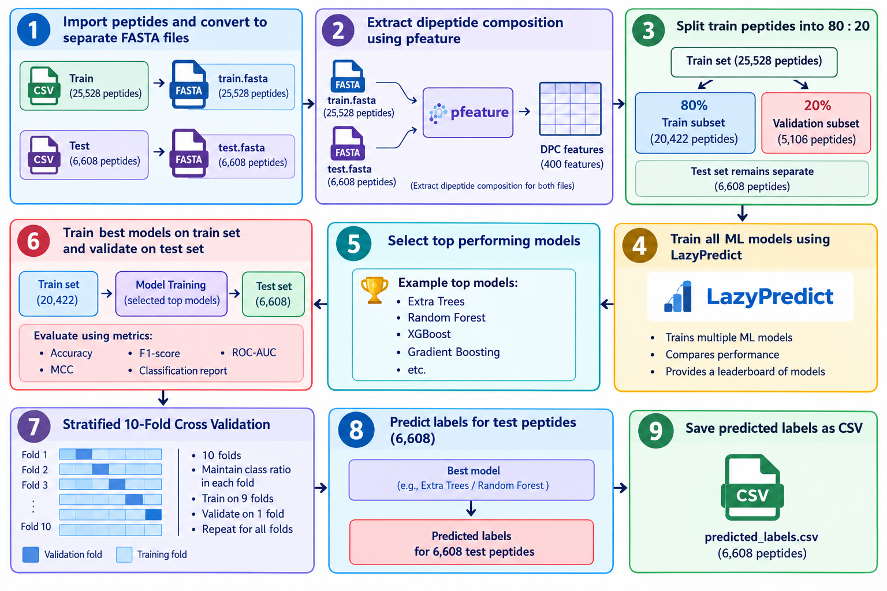
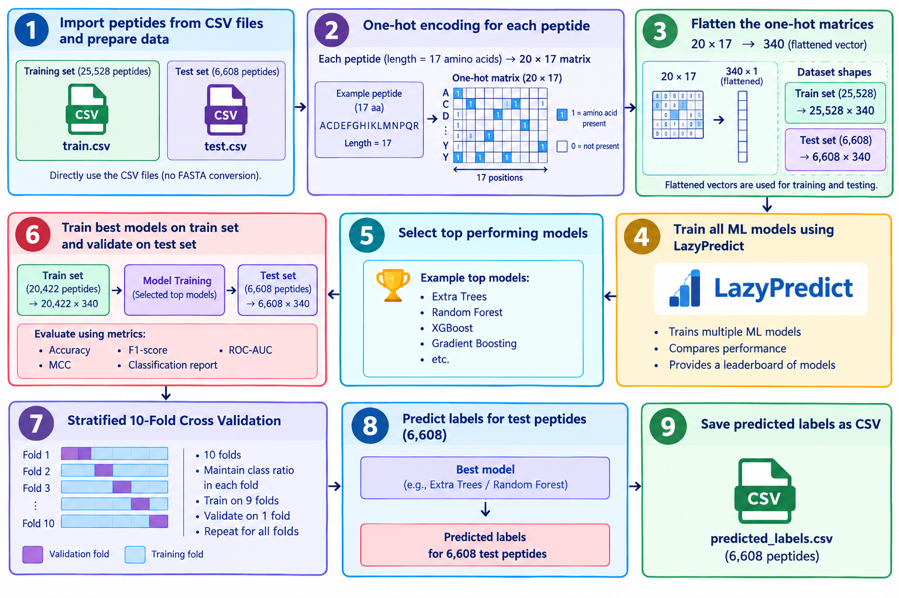

# IIITD_MLBA_Assignment_1
Contains the code and datasets for all submissions

## 2 Workflows are incorporated:

### Extracting features from the fasta files

Folders Sub_2 and Sub_3 have files based on this workflow.

### Extracting One-Hot Encoding for each peptide sequence

Folder Sub_4 have files based on this workflow
